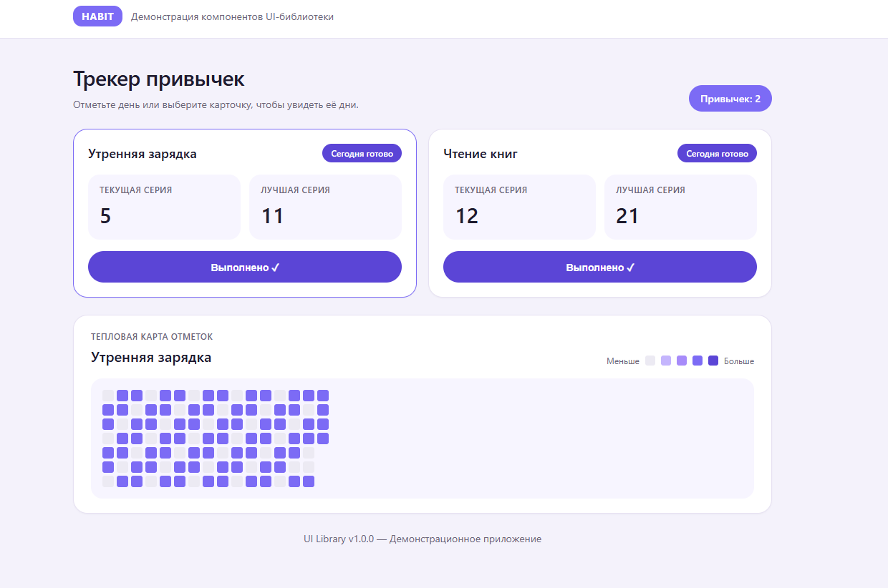

# UI-библиотека и демо-приложение (лабораторная работа #4)

## Описание

Два проекта:

1. **ui-library** (`@my-app/ui-library`) — библиотека UI-компонентов
2. **frontend** — презентационное приложение с примерами использования

### Компоненты библиотеки

#### HabitCard
- Название привычки
- Текущая серия
- Лучшая серия
- Кнопка «Отметить выполненным» / «Выполнено ✓»

#### Heatmap
- Сетка дней периода
- Интенсивность закраски зависит от факта выполнения
- Данные передаются через props (`data: HeatmapDay[]`)

## Запуск

### Библиотека

```bash
cd ui-library
npm install
npm run build
npm run lint
npm run test
npm run test:coverage
```

### Демо-приложение

```bash
cd frontend
npm install
npm run dev
```

Откройте http://localhost:5173

## Скриншоты


## Технологии

- React 19 + TypeScript
- Vite (library mode + app)
- ESLint (flat config, 2 spaces, no semi)
- Jest + Testing Library
- CSS Modules
- Без сторонних UI-библиотек
